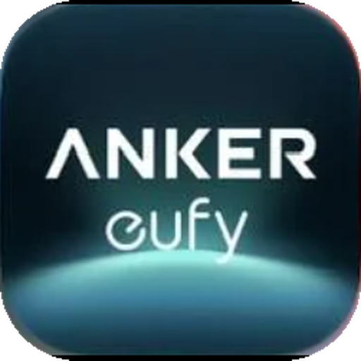

# Eufy Omni C28 for Home Assistant

A from-scratch Home Assistant integration for Eufy Clean "Omni" robot vacuums (tested on the
Omni C28 `T211A` and X10 Pro Omni `T2351`). Talks to the Eufy Clean cloud the way the app
does: HTTPS login, then a mutual-TLS MQTT connection that pushes the robot's state as
protobuf-encoded data points. No polling in normal operation.

* `eufy_omni_cloud/` – standalone async client (aiohttp + paho-mqtt + protobuf).
* `custom_components/eufy_omni/` – the integration: vacuum, sensors, binary sensors,
  buttons, selects, volume, services `eufy_omni.start_scene` / `eufy_omni.start_rooms`.
* `proto/cloud/` – message schemas extracted from the Eufy app by Martijn Poppen
  (licence in `proto/LICENSE-eufy-clean-protos.md`). Compile with `tools/build_protos.py`.
* `docs/PROTOCOL.md` – what the protocol looks like and what has been verified live.
* `tools/probe_*.py` – probes that read `EUFY_USERNAME` / `EUFY_PASSWORD` from the
  environment and write only sanitised fixtures.

## Install with HACS

1. In HACS open the three-dot menu, choose **Custom repositories**, paste
   `https://github.com/adamg23/Eufy-Omni` and pick category **Integration**.
2. Install **Eufy Omni C28** from the HACS store and restart Home Assistant.
3. Go to Settings → Devices & services → Add integration → **Eufy Omni C28** and sign in with
   the email and password you use in the eufy app. Every robot on the account is added.

## Install (manual)

1. `powershell -File tools/deploy.ps1` vendors the client into the component.
2. Copy `custom_components/eufy_omni` into your Home Assistant `config/custom_components/`.
3. Restart Home Assistant, add the **Eufy Omni C28** integration, sign in with your Eufy account.

## Icon

The integration ships its own icon in `custom_components/eufy_omni/brand/` (`icon.png`,
`icon@2x.png`). Home Assistant 2026.3 and newer serve it locally; older versions show the
generic placeholder.

## How this compares with other Eufy integrations in HACS

Three HACS integrations cover Eufy robot vacuums. They target different generations and
make different trade-offs; this table is written against each project's own documentation
(October 2026) and will drift as they evolve.

| | **Eufy Omni C28** (this project) | [jeppesens/eufy-clean](https://github.com/jeppesens/eufy-clean) | [damacus/robovac](https://github.com/damacus/robovac) |
|---|---|---|---|
| Robots it targets | MQTT-generation robots; tested on Omni C28 (T211A) and X10 Pro Omni (T2351) | MQTT-generation robots across the X, C, L, G and S series; tested on X10 Pro Omni and C28 Omni, plus an optional LAN path for non-MQTT Tuya robots | Older Tuya-based RoboVacs (G30, L35 Hybrid, X8 and others); the Omni / X10 / C28 are not Tuya devices and are not covered |
| Connection | Eufy cloud: HTTPS sign-in, then a mutual-TLS MQTT subscription; state is pushed by the robot, with a 5-minute cloud poll as fallback | Eufy cloud with MQTT (no cloud polling); optional direct LAN connection to the dock for Tuya robots, falling back to 30-second cloud polling | Local only, over the Tuya protocol using the robot's local key and device id; no cloud account |
| Setup | UI config flow (email + password); re-authentication flow when the password changes | UI config flow with an options dialog (map size, markers, notifications) | UI; requires obtaining the local key and device id with a third-party tool |
| Vacuum entity | start, pause, stop, return to dock, fan speed, locate, raw `send_command` | start, stop, pause, return to dock, find robot | start, stop, pause, return to base, locate |
| Routines ("scenes") | `eufy_omni.start_scene` by name or id; routine list exposed as an attribute | `scene_clean` via `vacuum.send_command`, plus a scene select entity | – |
| Room cleaning | `eufy_omni.start_rooms` (room ids + map id) | `room_clean` with per-room fan speed, mode and water level | – |
| Zone cleaning | – | `zone_clean` with rectangle coordinates and a bundled zone-drawing card | – |
| Live map | – (planned; the `biz/` map stream is received but not decoded) | Yes, as a camera entity: rooms, no-go zones, robot position, trail | – |
| Sensors | battery, state, dock activity, clean-water level, error code, last/total clean area, duration and count, Wi-Fi signal, last update, 8 consumable hour counters | battery, charging, work status and mode, cleaning area, lifetime totals, dock firmware, error code, consumable life, active map id | battery, cleaning status, error reporting |
| Binary sensors | charging, docked, dock connected, online, push connection, problem, do-not-disturb | charging | – |
| Selects / numbers | cleaning mode, water level, cleaning intensity; volume | suction, cleaning mode, water level, mop intensity, cleaning intensity, voice language, dock settings | – |
| Buttons | locate, refresh, wash mop | wash mop, dry mop, stop drying, empty dust bin, consumable resets | – |
| Diagnostics download | Yes, with identifying data redacted | – | – |
| Icon in the integration list | Ships inside the integration (`brand/`), shown on Home Assistant 2026.3+ | – | – |
| Code base | Independent client library and component, 25 unit tests; only the protobuf schemas are shared | Python port of martijnpoppen/eufy-clean | Fork of the original RoboVac integration |

In short: if you have a Tuya-era RoboVac, use **damacus/robovac**. If you have an Omni-generation
robot and want the live map, zone cleaning or consumable resets today, **jeppesens/eufy-clean**
has them. This project aims at a small, push-driven, well-tested core for the same robots, with
richer dock and consumable state and routines by name; the map is the main gap and is next on
the list.

## Credits

This integration would not exist without the people who worked out how the eufy app talks to
Eufy's cloud:

* [martijnpoppen/eufy-clean](https://github.com/martijnpoppen/eufy-clean) by Martijn Poppen –
  the original reverse engineering of the Eufy Clean cloud: login flow, the AIoT backend, the
  MQTT certificate hand-out, topic layout and message envelope, and the protobuf schemas that
  describe the robot's data points. The schemas under `proto/cloud/` are his work, reused under
  his licence (`proto/LICENSE-eufy-clean-protos.md`).
* [jeppesens/eufy-clean](https://github.com/jeppesens/eufy-clean) – the Python port of that
  work, which served as a reference for the data point numbering and message handling.

The client library and the Home Assistant component in this repository are an independent
implementation written from that knowledge; no code from either project is included.

## Licence

MIT for everything in this repository except the protobuf schemas under `proto/cloud/`,
which keep their upstream licence (`proto/LICENSE-eufy-clean-protos.md`).

## Notes

* Eufy rate-limits logins (HTTP 429). The integration stores its session token and only logs
  in again when the token is rejected.
* The live map stream (`biz/` topic) is not rendered yet.
* Data points 166 and 169 carry the Matter pairing code and the robot's MAC/SSID/IP; they are
  never written to fixtures or diagnostics.
